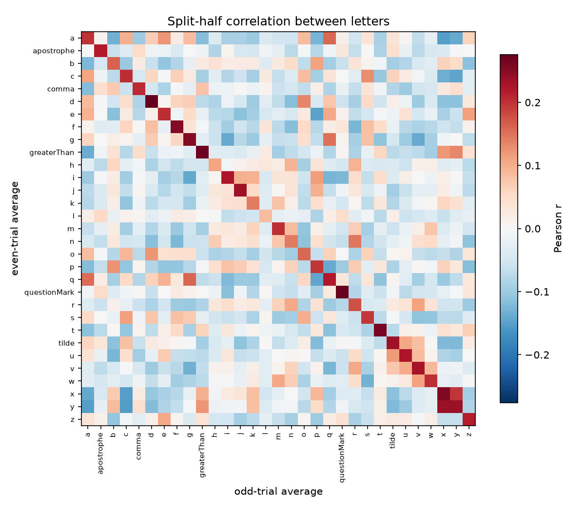
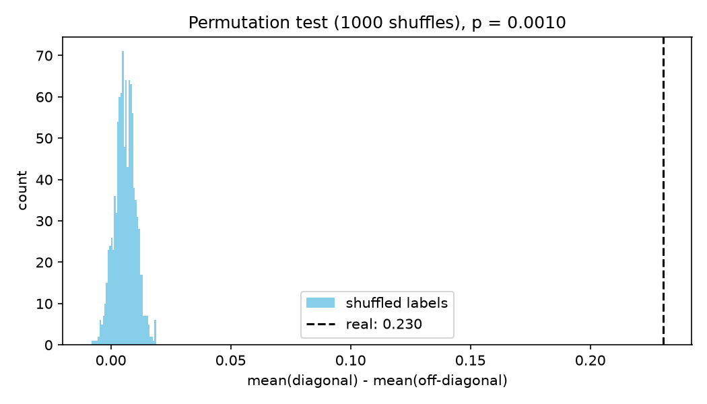

# Handwriting BCI: exploring the Willett et al. 2021 data

Working through the dataset of [Willett et al. 2021, *High-performance brain-to-text communication via handwriting*](https://www.nature.com/articles/s41586-021-03506-2) (Nature) as a feasibility study before attempting a reproduction. The data are intracortical (192-electrode) recordings from participant T5 imagining handwriting single characters.

This repository is a learning log: each step is a separate commit.

## Step 1: is the neural activity for a character reproducible?

`letter_split_half_test.py` asks whether the neural activity pattern for each character is consistent enough to be told apart from the other characters.

1. For each of the 31 characters, average the trials separately over the even- and odd-numbered trials and subtract the grand mean across characters.
2. Correlate every even-half pattern with every odd-half pattern (31 x 31 matrix, diagonal = same character).
3. Statistic = mean(diagonal) - mean(off-diagonal).
4. Shuffle the character labels of the trials, repeat, and compare (permutation test).

### Results (session `t5.2019.05.08`, 1000 shuffles)

| | |
|---|---|
| Within-letter (diagonal) mean r | 0.209 |
| Between-letter (off-diagonal) mean r | -0.022 |
| Real statistic (diagonal - off-diagonal) | 0.230 |
| Shuffled labels: mean / 95th percentile / max | 0.006 / 0.013 / 0.019 |
| p | 0.001 (the smallest possible with 1000 shuffles) |

All 201 time bins (delay period plus writing) and all 192 electrodes were used. 837 trials, 31 characters.




In the matrix, the letters x and y (and a/q/g) correlate with each other almost as strongly as with themselves.

Reading the result: the same character produces a measurably more similar pattern across independent halves of the trials than different characters do. The data carry character-specific structure.

Limits:
- One session, one participant.
- The test says the patterns are reproducible, not how accurately single trials could be decoded.
- The shuffled null is centered slightly above zero. This is expected: subtracting the grand mean pushes the off-diagonal correlations slightly negative. The null goes through the same pipeline, so the p-value is not affected.

## Run

Download the dataset from Dryad (see the paper's data availability statement; about 1.4 GB), unzip it into `data/` so that this file exists:

```
data/handwritingBCIData/Datasets/t5.2019.05.08/singleLetters.mat
```

```bash
pip install -r requirements.txt
python letter_split_half_test.py                 # defaults: 1000 shuffles, seed 47
python letter_split_half_test.py --n-perm 5000   # smaller p-value floor
```

Outputs: `figures/split_half_correlation.png`, `figures/permutation_null.png`, `results/split_half_correlations.csv` (the 31 x 31 matrix with letter labels). The data folder is git-ignored.

## Next steps

- Rank letter pairs by neural similarity and see which characters are most alike.
- Check whether the effect holds across session blocks.
- Try to get the official decoding pipeline running (TensorFlow 1.15, HMM labeling, language model).
